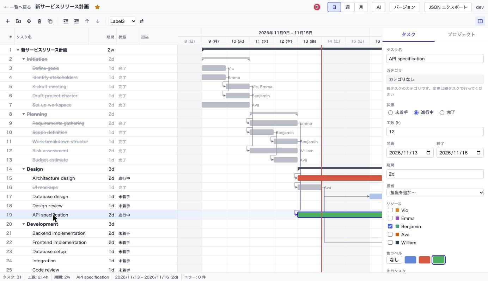
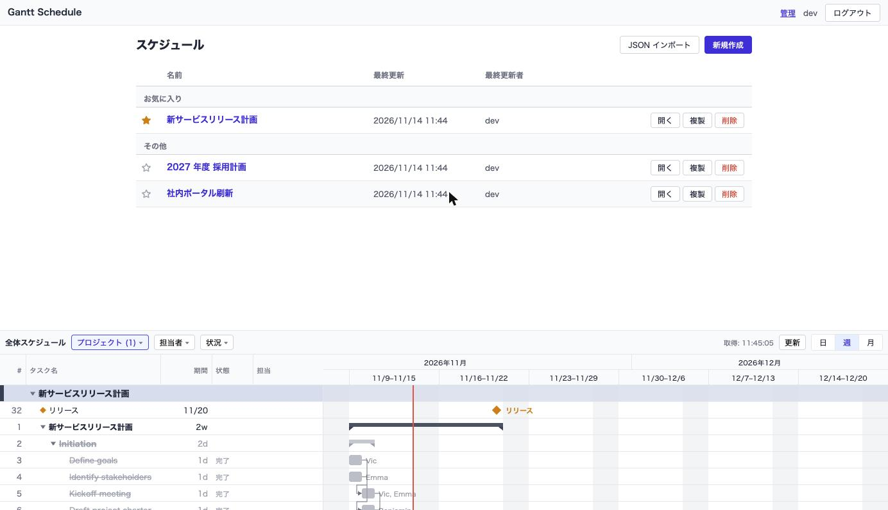

# Gantt Schedule

ガントチャート共有アプリです。複数人が同じスケジュールをブラウザで同時に編集できます。Cloudflare Workers (Hono) + D1 + Durable Objects で動き、画面は React 18 + TypeScript + Vite です。

## 画面

ガントチャート (タスクの詳細・担当・色ラベルを右ペインで編集):



スケジュール一覧 (お気に入りの固定) と、下部の全体スケジュール (複数のスケジュールを 1 つの時間軸に表示):



## 機能

- ガントチャート: 階層タスク、FS (終了-開始) 依存と自動スケジューリング、バーのドラッグ移動・リサイズ・依存線の作成、インライン編集、サイドパネル (プロジェクト・タスク・担当者・色ラベル・稼働日カレンダー)、日/週/月ズーム、折りたたみ、今日線、キーボード操作
- カテゴリ: 日付を持たない見出し行を作り、配下にタスクを階層的に紐づけます (ツールバーの「カテゴリを追加」、Shift+Enter)。カテゴリには期限・工数・担当者・依存・状態がなく、日程の集約も行いません。JSON では `"kind": "category"` のタスクです
- マイルストーン: 名前・詳細・日付 1 つを持つ項目です (ツールバーの「マイルストーンを追加」、Alt+Enter)。タイムラインにひし形で出て、ドラッグで日付を動かせます。期間・工数・担当・依存・状態を持たず、スケジューリングや集計の対象外です。JSON では `"kind": "milestone"` (start = end) のタスクです。
- 状態: タスクに 未着手 / 進行中 / 完了 を設定できます (JSON では `status`、省略時は未着手)。未着手のまま開始日を過ぎた、または未完了のまま終了日を過ぎたタスクは (閲覧者のローカルの今日で判定して) エラー表示になり、完了のタスクはグレーアウトして取消線で表示されます。進捗 (%) は廃止しました (古い JSON の `progress` は読み込めますが、無視されます)。
- タスクの詳細・コメント・担当: 右ペインの「詳細」に説明を書き、その下のコメントで誰がいつ書いたかを残して会話できます (コメントは書いた本人だけ編集・削除でき、スケジュール本体の JSON・バージョン・エクスポートには含まれません。D1 の `task_comments` 表に保存されます)。担当 (ユーザー) は複数設定でき、一覧の「担当」列とバーの右に表示されます (JSON では `assigneeIds`)。
- タスクのカテゴリ: 右ペインの「カテゴリ」欄で選ぶと、そのカテゴリの末尾へ移ります。カテゴリのないタスクは一覧の一番下の「カテゴリなし」にまとまります (トップレベルは常にカテゴリが先)。
- デプロイ後は、開いたままのタブを再読み込みしてください (古い画面のままだと、新しい種類のデータを表示できないことがあります)
- スケジュールの一覧、新規作成 (空 / JSON インポート / 複製)、JSON エクスポート、削除 (論理削除)
- 全体スケジュール (読み取り専用): ページ下部のペインの「プロジェクト」で選んだスケジュールを 1 つの時間軸にまとめて表示します (プロジェクト > カテゴリ > マイルストーン > タスク)。「担当者」「状況」でタスクを絞り込めます (いずれもチェックボックスで複数選択。未選択なら絞り込みません)。選択・絞り込み・折りたたみ・ズーム・高さはブラウザの localStorage に保存され、データは既存の `GET /api/schedules/:id` で取得します (リアルタイム更新は無く「更新」ボタンで取り直します)。
- お気に入り: 一覧の各行の星で、自分用にスケジュールを上に固定できます (ユーザーごとにサーバーの D1 `schedule_favorites` 表へ保存され、別の端末でも同じ。一覧に出るスケジュールと権限は変わらず、他の人のお気に入りには影響しません)。スケジュール画面のヘッダーの星からも切り替えられます (`PUT` / `DELETE /api/schedules/:id/favorite`)。
- 同時編集とプレゼンス (接続中のユーザー、選択中のタスク)。切断時は読み取り専用になり、再接続後に最新データを取り直します
- バージョン: 名前を付けて保存、一覧・閲覧・「このバージョンに戻す」。復元の直前と AI 適用の直前に自動でバージョンを作ります。手動 10 件・自動 10 件を別枠で保持し、超えた分は同じ種別の古いものから消えます
- AI ペイン: 指示文からタスクの追加・変更・削除を提案し、差分をプレビューしてから適用します (Anthropic / OpenAI / Gemini)
- Google ログイン。許可ドメイン、管理者、例外アドレスでアクセスを制御します
- 管理画面 (`/admin`、管理者のみ): 例外アドレスの追加・削除、ユーザー一覧 (閲覧のみ)、削除済みスケジュールの復元

Undo/Redo はありません。明示的な「保存」操作もなく、編集は自動で保存されます。

## ローカル開発

前提: Node.js 22.13 以上、pnpm。

```sh
pnpm install
cp .dev.vars.example .dev.vars   # 必要なら中身を編集
pnpm db:migrate:local            # ローカルの D1 にマイグレーションを適用
pnpm dev                         # http://localhost:5173 (ポートは --port で変更)
```

- `.dev.vars` はローカル専用で git 管理外です。`ALLOWED_DOMAINS` / `ADMIN_EMAILS` / `DEV_LOGIN_EMAIL` を設定します。
- 開発用ログイン: `.dev.vars` の `DEV_LOGIN_EMAIL` (カンマ区切りで複数) を設定すると、ログイン画面に「開発用ログイン」ボタンが出ます。`/auth/dev-login?as=<email>` でも入れます。localhost 系のホストでのみ有効で、未設定なら 404 です。Google の設定なしで動かせます。
- Google ログインを試すときは `GOOGLE_CLIENT_ID` / `GOOGLE_CLIENT_SECRET` を `.dev.vars` に書き、リダイレクト URI に `http://localhost:<ポート>/auth/callback` を登録します (手順は [docs/DEPLOY.md](docs/DEPLOY.md))。

## コマンド

| コマンド | 内容 |
| --- | --- |
| `pnpm dev` | 開発サーバー (Vite + workerd) |
| `pnpm typecheck` | 型検査 (client / worker / node / worker-test の 4 設定) |
| `pnpm test` | 単体テスト (vitest) |
| `pnpm build` | 型検査 + 本番ビルド (`dist/`) |
| `pnpm db:migrate:local` / `pnpm db:migrate:remote` | D1 マイグレーション適用 (ローカル / 本番) |
| `pnpm run deploy` | ビルドして本番へデプロイ (`pnpm deploy` ではなく `pnpm run deploy`)。マイグレーションがある更新は必ず先に `pnpm run db:migrate:remote` (逆だと一覧と各スケジュールが 500 になる) |
| `pnpm gen:types` / `pnpm gen:validator` | JSON スキーマから型・検証関数を再生成 |

## テスト

`pnpm test` は engine (計画・依存・コマンド)、スキーマ検証、認証の許可判定、スケジュール API、バージョン、管理 API、Durable Object のコア、クライアントのストア・同期・AI のロジックを対象にします。D1 を使うテストは、本物のマイグレーションを node:sqlite (SQLite) に流して実行します。

ブラウザ操作の e2e (複数ブラウザの同時編集など) はこのリポジトリには含まれていません。

## ディレクトリ構成

```
src/
  client/    React アプリ (pages, components, store, sync, ai, i18n)
  worker/    Hono の Worker
    auth/      Google OIDC、セッション、許可判定
    schedules/ スケジュール・バージョンの API と D1 アクセス
    admin/     管理 API
    room/      Durable Object (ScheduleRoom) とそのコア
  shared/    client と worker の両方が使う純関数 (engine, model, 名前・メールの検証, 同期プロトコル)
migrations/  D1 のマイグレーション
public/      静的ファイル (_headers = CSP などのヘッダー)
schema/      JSON スキーマ (version 1)
docs/        デプロイ手順書
wrangler.jsonc
```

## 設計の要点

- **Durable Object による直列化**: スケジュールごとに Durable Object (SQLite バックエンド、WebSocket Hibernation API) が 1 つあり、そのスケジュールへの編集・バージョン作成・復元を到着順に 1 件ずつ処理します。永続化の正は D1 で、DO は doc をキャッシュします (rev による楽観ロックで D1 と食い違いを検出)。
- **コマンド同期**: クライアントは編集を engine の Command 単位で送ります。DO が `executeCommand` で適用し、結果を全接続へ配信して D1 へ保存します。同時編集は「コマンド単位の到着順」で、文字単位のマージはしません。
- **バージョン**: 全データのスナップショットを D1 に保存します。
- **AI は鍵をブラウザに保持**: API キーとモデルは localStorage にだけ置き、ブラウザからプロバイダーへ直接リクエストします (Worker を通りません)。返答は Command 列として検証し、差分をプレビューしてから適用します。
- **認証**: Worker 内で Google OIDC (state + nonce + PKCE、ID トークンの署名・aud・iss・exp・email_verified を検証)。セッションは D1 に保存し、リクエストごとに現在の設定で許可を再判定します (許可されなくなったユーザーは次のアクセスで失効。WebSocket 接続中のユーザーは DO が 60 秒間隔で再判定)。
- **セキュリティヘッダー**: 静的ファイルには `public/_headers`、Worker の応答には `src/worker/securityHeaders.ts` で CSP などを付けます (同じ内容を両方に書いています)。

## ライセンス

[MIT](LICENSE)
